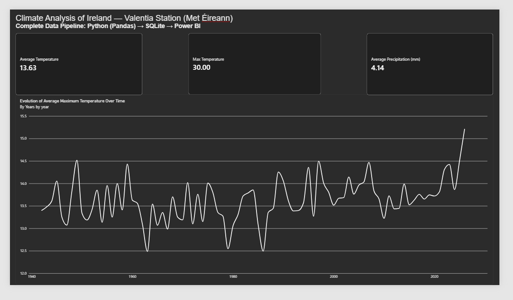

# 🇮🇪 Ireland Climate Data Pipeline & Dashboard

An end-to-end data engineering and analytics project built with historical climate data from the **Valentia Island Station (Met Éireann)** in Ireland, covering daily observations from 1940 to the present.

---

## Project Overview

The main objective of this project is to collect, process, store, and visualize decades of Irish climate metrics (temperature, rainfall, etc.) to identify long-term environmental trends.

This project demonstrates a complete data pipeline lifecycle:
1. **Extraction & Transformation (ETL):** Data clean-up, missing value handling, and structuring using Python and Pandas.
2. **Storage:** Storing structured data in a local **SQLite** relational database for efficient querying.
3. **Data Export:** Exporting clean subsets for downstream reporting.
4. **Data Visualization:** Building an interactive, high-contrast dark-themed dashboard in **Power BI Desktop**.

---

## Tech Stack & Tools

* **Programming Language:** Python 3.x
* **Data Manipulation:** Pandas, openpyxl
* **Database:** SQLite
* **Business Intelligence:** Power BI Desktop
* **IDE & Version Control:** PyCharm, Git, GitHub

---

## Power BI Dashboard Preview



> *Note: The dashboard features key performance metrics (maximum historical temperature, overall average temperature, average rainfall) and an interactive temporal trend visualization over time.*

---

## Repository Structure

```text
├── ireland_climate.py       # Main Python script (ETL & SQLite integration)
├── ireland_climate.db       # SQLite relational database
├── ireland_climate.png      #PowerBI screenshot
├── ireland_climate.xlsx     # Exported processed dataset (or .csv)
├── .gitignore               # Excluded environment & system files
└── README.md                # Project documentation
